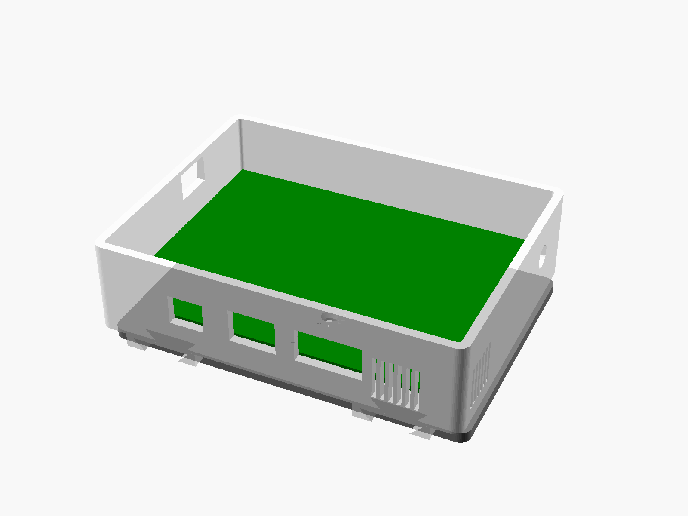
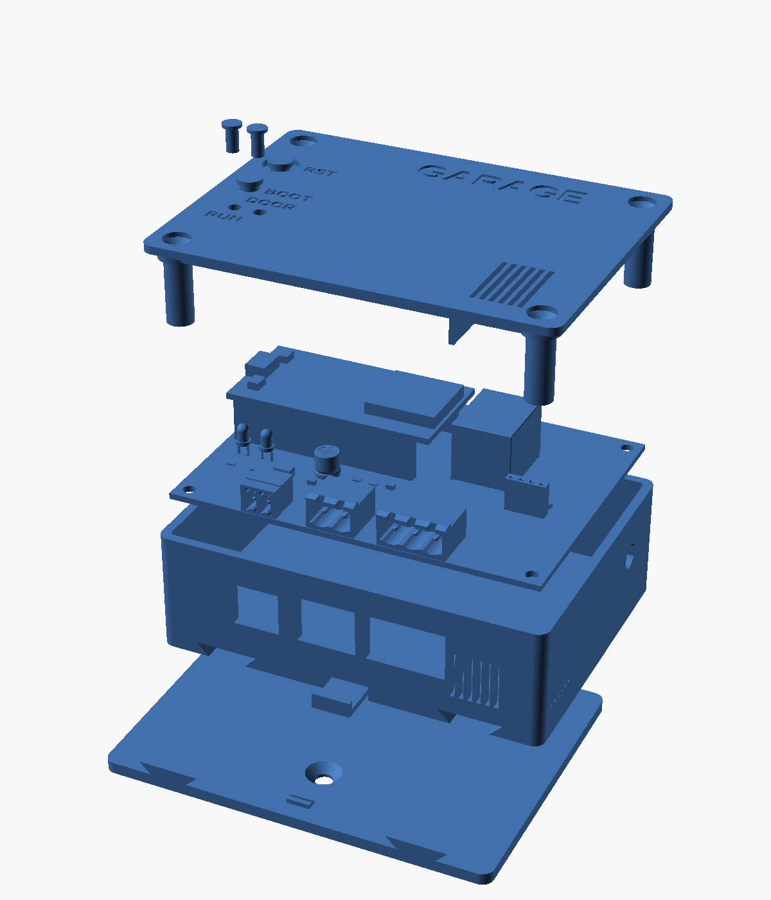

# Garage opener enclosure (rev 1)

A 3D-printed, wall-mounted case for the rev 1 carrier PCB (`../garage-opener-pcb`). It has three parts:

- a **wall bracket** that you screw to the wall;
- a **base** that slides down onto the bracket and clicks into place (a flexible tongue in its back snaps over a catch on the bracket);
- a **lid** that shows the two LEDs and has push-buttons for the devkit's BOOT and EN (RST) buttons.

The power, reed and relay plugs go in from below without opening the case. USB is on the left side and
the antenna (SMA) on the right.

## Parts (`stl/`)

| File | Qty | Print orientation |
|------|-----|-------------------|
| `bracket.stl` | 1 | flat, wall side down (rails and catch up) |
| `base.stl` | 1 | lying on its back (the solid back slab on the plate, open side up); the grooves and the latch tongue's air gap print as 45° overhangs and short bridges |
| `lid.stl` | 1 | **upside down**: outer face on the plate (labels and countersinks then print cleanly) |
| `btn_boot.stl`, `btn_en.stl` | 1 each | cap down |
| `lightpipe.stl` | 2 (optional) | flange down, clear or white PLA |
| `fittest.stl` | 1 | as exported (two strips): print this **first** |

**Reference models, not for printing:**
- `assembly.stl` has every piece, including the PCB with its components and a stand-in devkit, in its final
  position, with the box closed on the bracket.
- `assembly_exploded.stl` has the same pieces pulled apart in the order they go together:
  1. the bracket on the wall;
  2. the base sliding down onto it;
  3. the PCB dropping into the base;
  4. the lid and buttons on top;
  5. the light pipes above their holes.

All STLs are exported in their assembled position, so turn each one into its print orientation in Bambu Studio.

**Settings (Bambu Lab P1S):** PLA, 0.2 mm layers, 4 walls, 20 % gyroid infill, no supports.

**Label colour (optional):** the lid's labels are debossed 0.6 mm. To colour them, add a filament change at
the layer where the label floors end (0.6 mm above the plate).

**PLA warning:** PLA softens at about 55 °C. Don't mount the box in direct sun or on the opener motor. The
same files print in PETG if you need more heat resistance.

## Hardware

- 4 × M3 heat-set inserts (M3 × 5 × 4 mm), for the base bosses.
- 4 × M3 × 25 countersunk screws, for the lid. They go through the lid tubes and the PCB's mounting
  holes into the inserts, so they also clamp the PCB. The lid counterbores the heads so the tips land
  4 mm into the inserts. If you use another length, set `lid_screw_len` in `params.scad`;
  `check_fit.py` checks it.
- U.FL (IPEX1) → SMA-female bulkhead pigtail (about 10 cm) and a 2.4 GHz SMA antenna.
- 2 × 4 mm wood screws and wall plugs, for the bracket.
- Mating plugs: Phoenix MC 1,5/2-ST-3,81 (power), MSTB 2,5/2-ST-5,08 (reed) and MSTB 2,5/3-ST-5,08
  (relay). "15EDGK"/"2EDGK" clones also fit.

## Before printing the box

1. **Measure your devkit** and correct `devkit_dims.scad`. The defaults come from Espressif's DevKitC V4
   drawing, and clones differ. Check:
   - **first, `seat_h`:** the height of the devkit PCB's underside above the carrier when it is plugged
     into its sockets. That's the 8.5 mm female header plus the devkit's own ~2.5 mm male-header strip.
     Every other height (USB, buttons, lid) builds on it;
   - the USB connector (position, width, height);
   - the BOOT and EN switch positions;
   - the height of the tallest part.
2. **Print `fittest.stl`.** It holds the bottom 16 mm of the base and the bottom 16 mm of the bracket. Check:
   - the base strip has all three plug cut-outs, both groove mouths and the latch tongue with its tab;
   - the bracket strip has both rails and the catch;
   - the rails slide into the grooves;
   - the catch clicks into the tongue's window, and pulling the tab releases it;
   - all three plugs go fully home in their headers through the cut-outs.

   If anything doesn't fit, adjust `dovetail` / `slip` in `params.scad`.
3. Regenerate and check:

       python3 export_board_dims.py   # only after a PCB change (run ../garage-opener-pcb/fab.sh first)
       python3 test_board_dims.py
       python3 check_fit.py           # board/cut-out/LED/button/lid-clearance alignment
       sh make_stl.sh                 # STLs + PNG renders

   This needs OpenSCAD (`brew install --cask openscad@snapshot`; the stable cask is disabled) and KiCad 10
   for `export_board_dims.py`.

## Assembly

1. Melt the four inserts into the base bosses with a soldering iron at about 200 °C.
2. Fit the SMA bulkhead in the right-hand D-hole, with its flat against the flat of the hole, and tighten
   the nut.
3. Put the PCB on the bosses. Plug the devkit into its sockets and clip the U.FL onto the WROOM-32U.
4. Push the BOOT and EN buttons into their lid sleeves from outside until the cone clicks through. EN is
   the one in the recess, marked RST.
5. Put the lid on and screw it down with the four M3 × 25 screws. This also clamps the PCB.
6. Screw the bracket to the wall, rails facing out, with the catch at the bottom.
7. Slide the box down onto the bracket rails until the latch clicks.
8. Plug in the power, reed and relay cables from below.

**Removing the box:** pull the three plugs, then hook a finger behind the release tab under the
bottom centre of the box. Pull it away from the wall about 2 mm and lift the box off.

## Files

| File | What |
|------|------|
| `enclosure.scad` | the model; `-D 'part="base"'` etc. selects a part |
| `params.scad` | tolerances and wall sizes |
| `devkit_dims.scad` | devkit measurements (edit after measuring) |
| `board_dims.scad` | **generated** from the PCB by `export_board_dims.py` (do not edit) |
| `check_fit.py`, `test_board_dims.py` | checks |
| `make_stl.sh` | exports `stl/` and `renders/` |
