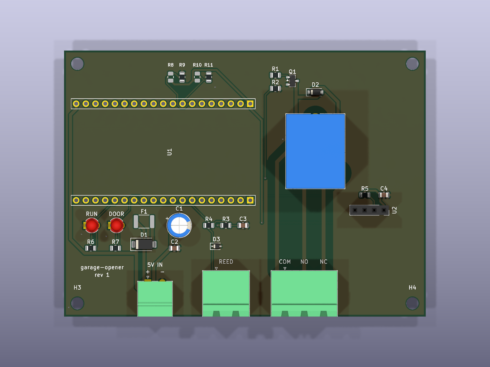
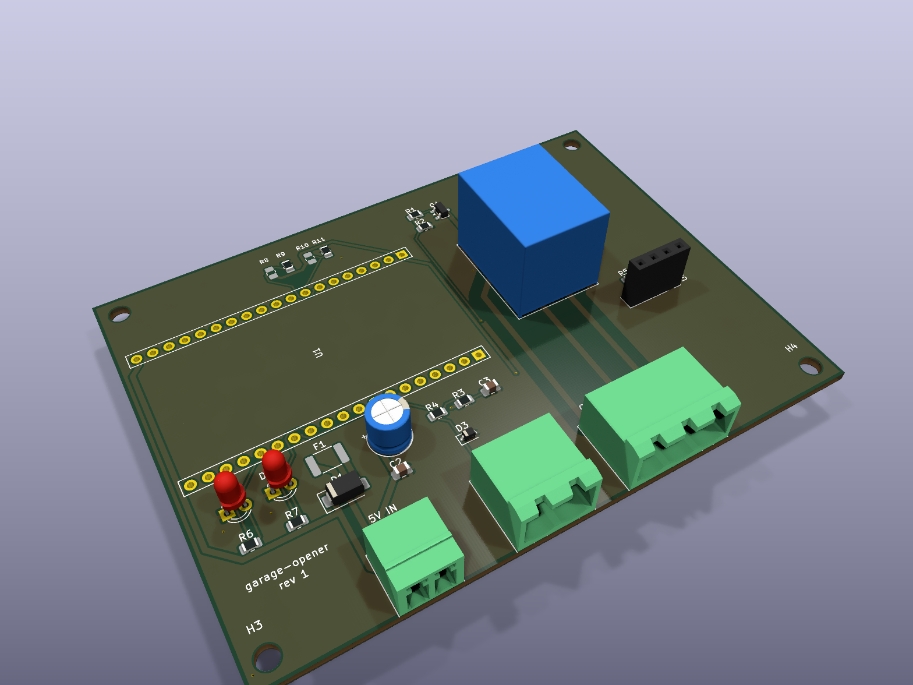

# Garage opener carrier PCB (rev 1)

KiCad 10 project for a carrier board that an **ESP32 DevKitC V4 (ESP32-WROOM-32U, 38-pin)** plugs
into. It adds a 5 V screw-terminal input (PTC fuse + Schottky), an on-board SRD-05VDC relay for the
opener's push-button input, a protected reed-switch input, an on-board DHT22, RUN/DOOR LEDs and two
board-ID straps. The GPIO map is identical to the prototype (`main/board.h`), so the same firmware
and OTA image run on both.

- Schematic: `garage-opener-pcb.kicad_sch` (PDF: `../../docs/Schematic_GarageOpener.pdf`)
- BOM: `bom.csv` (DNP parts excluded); printable version `../../docs/BOM_GarageOpener.pdf`,
  regenerated with `python3 make_bom_pdf.py` after re-exporting `bom.csv`. U1 is the devkit itself; its footprint needs two
  1x19 2.54 mm female headers, which are not a separate BOM line.
- Design + bring-up checklist: `../../docs/superpowers/specs/2026-10-16-carrier-pcb-schematic-design.md`

## Checking the schematic after edits

    python3 check_schematic.py

Exports the netlist with `kicad-cli` and checks every net, footprint, the DNP ID straps, and that
each GPIO in `main/board.h` lands on the right circuit. Run ERC too:

    kicad-cli sch erc --severity-all garage-opener-pcb.kicad_sch

Expected: 0 errors; 1 warning that the embedded `MMBT2222A` differs from the library copy (it is a
flattened derived symbol) is harmless.

## Before ordering a PCB

- Measure the devkit: rows must be 25.4 mm apart (footprint `garage-opener:ESP32-DevKitC-V4_Socket`).
- Power J1 from a **5.1–5.2 V** supply: the Schottky + PTC drop ~0.45 V, and the devkit's LDO needs ~4.3 V.
- Check whether the devkit has a diode on USB VBUS before using USB and J1 at the same time.
- Board ID rev 1 = `00` (R9, R11 fitted). Future revisions: fit R8 and/or R10 instead.
- J1–J3 are pluggable Phoenix-style headers. J1 (power) is 3.81 mm pitch and J2/J3 are 5.08 mm, so the
  power plug can't go into the reed socket.
- Relay contacts follow KiCad's SRD symbol (J2: 1 COM, 2 NO, 3 NC). On the first board, confirm
  with a meter that COM–NO is open while the relay is unpowered.

## PCB

Renders: `kicad-cli pcb render --side top ...` and `--perspective --rotate '-40,0,30'`. KiCad's stock LED
model is red (the BOM has green RUN / amber DOOR), U2 shows as a socket (the DHT22 is soldered flat), and
the devkit has no 3D model.

- `garage-opener-pcb.kicad_pcb` is the source of truth. `tools/layout.py`, `tools/route.py` and
  `tools/silk.py` built rev 1 from scratch. Layout refuses to overwrite without `--force`, which
  discards the routing. `route.py --refill-only` refills the GND pours and adds stitching vias.
- Check after any edit: `python3 check_pcb.py`. It checks placement, connector/USB orientation and
  the silkscreen labels, that the custom rules in `garage-opener-pcb.kicad_dru` load, DRC, unconnected
  items and schematic parity.
- Fab files: `sh fab.sh`, then upload `fab/garage-opener-pcb-gerbers.zip` to Aisler (2 layers,
  1.6 mm, HASL). Aisler also accepts the `.kicad_pcb` directly. `fab/` also has a STEP model and an STL;
  the enclosure scripts read the STL.
- The DHT22 is soldered **flat** (leads bent 90°, grille facing the lid) over the marked keep-out,
  not in a socket.
- Relay contact tracks are 1 mm wide with 2 mm clearance to everything else (net class `Contact`).
- Enclosure: `../enclosure/` (generated from this board; rerun its `export_board_dims.py` after moving parts).
